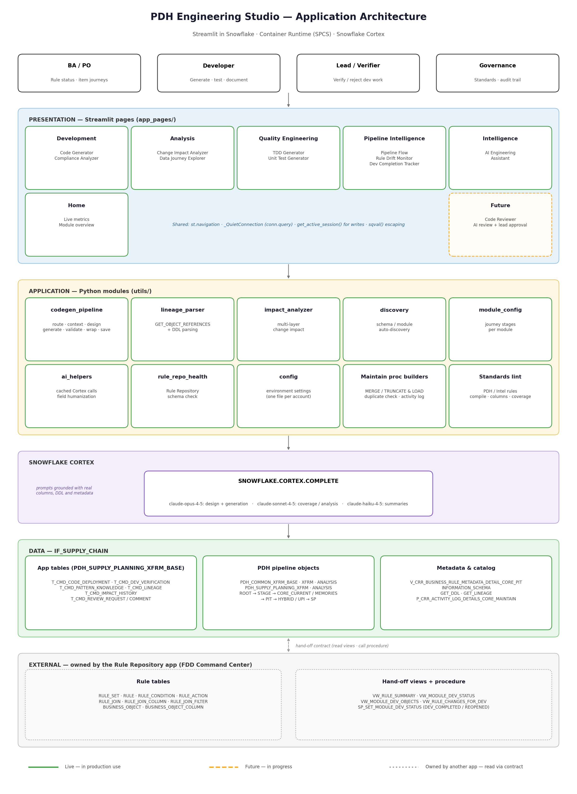
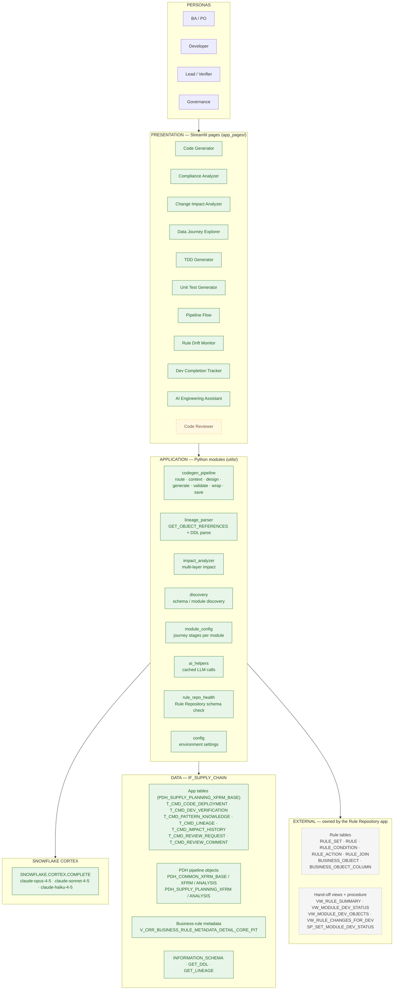
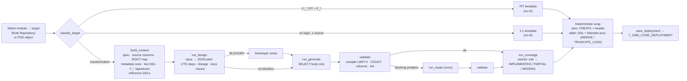

# PDH Engineering Studio — Architecture

Streamlit in Snowflake · Container Runtime (SPCS) · Snowflake Cortex



## 1. Layered view



**Legend:** green = live · amber dashed = future · grey dashed = owned by another app.

### ASCII fallback

```
┌──────────────────────────────────────────────────────────────────────────────┐
│ PERSONAS        BA / PO   ·   Developer   ·   Lead / Verifier   ·   Governance│
└──────────────────────────────────────────────────────────────────────────────┘
                                    │
┌─ PRESENTATION — Streamlit pages ─────────────────────────────────────────────┐
│ Development     Code Generator · Compliance Analyzer                          │
│ Analysis        Change Impact Analyzer · Data Journey Explorer                │
│ Quality Eng.    TDD Generator · Unit Test Generator                           │
│ Pipeline Intel. Pipeline Flow · Rule Drift Monitor · Dev Completion Tracker   │
│ Intelligence    AI Engineering Assistant                                      │
│ Future          Code Reviewer                                                 │
└──────────────────────────────────────────────────────────────────────────────┘
                                    │
┌─ APPLICATION — utils/ ───────────────────────────────────────────────────────┐
│ codegen_pipeline · lineage_parser · impact_analyzer · discovery              │
│ module_config · ai_helpers · rule_repo_health · config                       │
└──────────────────────────────────────────────────────────────────────────────┘
                 │                                        │
┌─ SNOWFLAKE CORTEX ───────────────┐    ┌─ DATA — IF_SUPPLY_CHAIN ─────────────┐
│ COMPLETE: opus-4-5 · sonnet-4-5 │    │ App tables  T_CMD_*                   │
│           · haiku-4-5           │    │ PDH pipeline objects (ROOT→PIT→SP)    │
└──────────────────────────────────┘    │ Metadata view · INFORMATION_SCHEMA   │
                                        └──────────────────────────────────────┘
                                                          │
┌─ EXTERNAL — Rule Repository app ─────────────────────────────────────────────┐
│ Rule tables · VW_MODULE_DEV_STATUS · VW_MODULE_DEV_OBJECTS                    │
│ VW_RULE_CHANGES_FOR_DEV · VW_RULE_SUMMARY · SP_SET_MODULE_DEV_STATUS          │
└──────────────────────────────────────────────────────────────────────────────┘
```

## 2. Runtime

| Item | Value |
|---|---|
| Streamlit object | `SNOWFLAKE_LEARNING_DB."PRITIX.M.SHARMA@INTEL.COM_SEMANTIC_MODEL".PDH_COMMAND_CENTER` |
| Run mode | Container Runtime (`SpcsOnly`), compute pool `SYSTEM_COMPUTE_POOL_CPU` |
| Execute as | OWNER |
| Query warehouse | `IF_WH_SCHAIN_IFPDH_CONSUMPTION` |
| Packages | `streamlit[snowflake]>=1.54`, `openpyxl` (from `SNOWFLAKE.SNOWPARK.PYPI_SHARED_REPOSITORY`) |
| Entry point | `streamlit_app.py` — page config, global CSS, `st.navigation`, shared connection |

### Connections

| Purpose | Mechanism |
|---|---|
| Reads | `st.session_state["conn"]` — `st.connection("snowflake")` wrapped by `_QuietConnection` (plain spinner, `conn.query(sql, ttl=…)`) |
| Writes (INSERT / UPDATE / CALL) | `snowflake.snowpark.context.get_active_session().sql(q).collect()` |
| Literal escaping | `sqval()` — escapes `\` and `'` before any value enters SQL |

## 3. Code generation pipeline (`utils/codegen_pipeline.py`)



### Validation and lint

| Check | Severity |
|---|---|
| Compiles (`SELECT * FROM (body) LIMIT 0`) | Blocking |
| Output columns = target spec | Blocking |
| Hardcoded metadata values outside the metadata CTE | Critical |
| Raw source used where a PDH ROOT view exists | Critical |
| Object not in the source catalog | Warning |
| CROSS JOIN on a metadata CTE with more than one row | Warning |
| `RANK` / `DENSE_RANK() = 1` (keeps ties) | Warning |
| `SELECT *`, `ORDER BY` in a view | Warning |
| Pass-through CTE | Info |

### Maintain procedure patterns

| Pattern | Chosen when | Behaviour |
|---|---|---|
| **MERGE** | Default, or the rule / FDD text says merge / upsert / incremental | Duplicate check → `BEGIN TRANSACTION` → MERGE with `IUDInd` (I/U/D), `COALESCE(s.key, t.key)`, soft delete via `DELETE_IND` (physical delete when there is no `DELETE_IND`), reactivation, null-safe diff → `COMMIT`; `ROLLBACK` in handlers |
| **TRUNCATE & LOAD** | The text says truncate / full load, or the user selects it | Duplicate check → `TRUNCATE` → `INSERT … SELECT` |
| Both | — | `duplicate_records_from_source` EXCEPTION (-20100), separate handlers, activity log via `PDH_COMMON_XFRM_BASE.P_CRR_ACTIVITY_LOG_DETAILS_CORE_MAINTAIN` |

## 4. Page → module → object map

| Page | utils modules | Main Snowflake objects |
|---|---|---|
| Home | — | `T_CMD_PATTERN_KNOWLEDGE`, `T_CMD_IMPACT_HISTORY`, `RULE_SET`, `V_BRD_ITEM_CORE_PIT` |
| Code Generator | codegen_pipeline, rule_repo_health | `VW_MODULE_DEV_STATUS`, `VW_MODULE_DEV_OBJECTS`, `VW_RULE_SUMMARY`, rule tables, `BUSINESS_OBJECT_COLUMN`, metadata view, `T_CMD_PATTERN_KNOWLEDGE`, `T_CMD_CODE_DEPLOYMENT`, INFORMATION_SCHEMA, GET_DDL |
| Compliance Analyzer | rule_repo_health, ai_helpers | Rule tables, INFORMATION_SCHEMA, GET_DDL |
| Change Impact Analyzer | impact_analyzer, lineage_parser | `T_CMD_LINEAGE`, `T_CMD_PATTERN_KNOWLEDGE`, `T_CMD_IMPACT_HISTORY`, INFORMATION_SCHEMA.COLUMNS |
| Data Journey Explorer | module_config | Source, ROOT, STAGE, CORE_CURRENT / MEMORIES, PIT, HYBRID / UPI, SP views; metadata view |
| TDD Generator | ai_helpers | `T_CMD_PATTERN_KNOWLEDGE`, INFORMATION_SCHEMA |
| Unit Test Generator | ai_helpers | Rule tables, INFORMATION_SCHEMA, `T_CMD_PATTERN_KNOWLEDGE` |
| Pipeline Flow | discovery, lineage_parser | Pipeline objects (row counts) |
| Rule Drift Monitor | — | `T_CMD_CODE_DEPLOYMENT`, rule tables |
| Dev Completion Tracker | — | `VW_MODULE_DEV_STATUS`, `VW_MODULE_DEV_OBJECTS`, `VW_RULE_CHANGES_FOR_DEV`, `SP_SET_MODULE_DEV_STATUS`, `T_CMD_CODE_DEPLOYMENT`, `T_CMD_DEV_VERIFICATION`, GET_DDL |
| AI Engineering Assistant | ai_helpers | Rule tables, pipeline objects |
| Code Reviewer | ai_helpers | `T_CMD_REVIEW_REQUEST`, `T_CMD_REVIEW_COMMENT` |

## 5. Data model — app-owned tables

All in `IF_SUPPLY_CHAIN.PDH_SUPPLY_PLANNING_XFRM_BASE`. DDL for the pattern, lineage, impact and review tables is in `ddl/`. `T_CMD_CODE_DEPLOYMENT` and `T_CMD_DEV_VERIFICATION` were created directly in Snowflake (`GET_DDL('TABLE', …)` gives their current definition).

| Table | Purpose | Key columns |
|---|---|---|
| `T_CMD_CODE_DEPLOYMENT` | One row per generation | DEPLOYMENT_ID, TARGET_OBJECT, GENERATION_MODE (RULE_REPOSITORY / FDD_EXCEL), RULE_IDS, RULE_SNAPSHOT, RULE_HASH, GENERATED_SQL, GENERATION_PROMPT_HASH, STATUS, DEPLOYED_BY, GENERATED_TS, DEPLOYED_TS, NOTES (JSON: models, design, validation, coverage) |
| `T_CMD_DEV_VERIFICATION` | Dev completion and lead verification | VERIFICATION_ID, DEPLOYMENT_ID, STATUS (DEV_COMPLETED / VERIFIED / REJECTED), DEV_COMPLETED_BY / TS, DEV_NOTES, VERIFIED_BY / TS, VERIFICATION_NOTES |
| `T_CMD_PATTERN_KNOWLEDGE` | Pattern library of PDH objects | OBJECT_NAME, OBJECT_SCHEMA, OBJECT_TYPE, LAYER, MODULE, PATTERN_CATEGORY, DDL_SAMPLE, SCANNED_DTM |
| `T_CMD_LINEAGE` | Object / column lineage edges | Source and target object, column, relationship |
| `T_CMD_IMPACT_HISTORY` | Saved impact analyses | Change, scope, result |
| `T_CMD_REVIEW_REQUEST` / `T_CMD_REVIEW_COMMENT` | Code review workflow | Request, reviewer, status, comments |

### Status flow on `T_CMD_CODE_DEPLOYMENT.STATUS`

```
GENERATED ──(developer: Mark as Dev Completed)──► DEV_COMPLETED ──(lead)──► VERIFIED
                                                               └──(lead)──► REJECTED
```

## 6. Security

- The app runs with **owner's rights**; users get access through the app's sharing role (`ROLE_IF_CDA_PDH_SUPPLY_PLANNING_ANALYSIS_CONTRIBUTOR`).
- The app writes **only** to its own `T_CMD_*` tables, plus the Rule Repository's `SP_SET_MODULE_DEV_STATUS` procedure. Generated DDL is shown and downloaded, never executed by the app.
- Every user-supplied value is escaped through `sqval()` before entering SQL. Cortex prompts are passed as `$$`-quoted strings, with `$$` sequences neutralised.
- Lead actions in the Dev Completion Tracker are restricted to the configured lead list.
